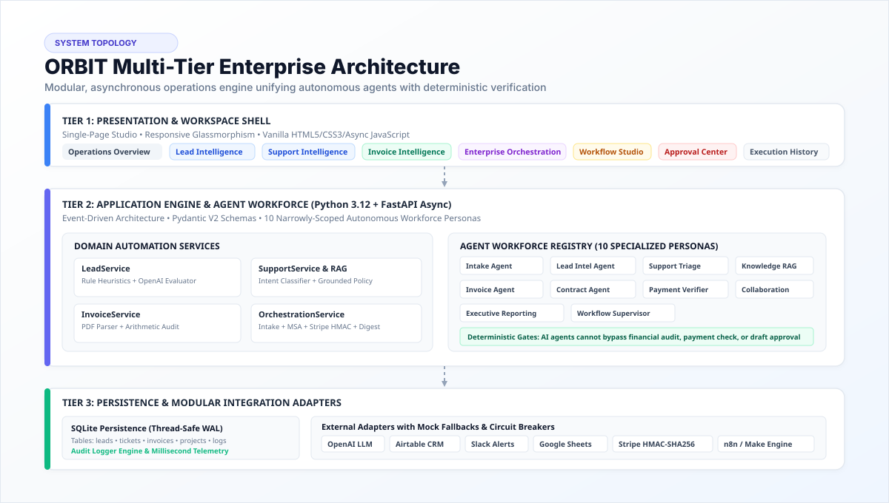

# ORBIT AI Operations Studio

<p align="center">
  
</p>

<p align="center">
  <a href="https://python.org"></a>
  <a href="https://fastapi.tiangolo.com"></a>
  <a href="https://pydantic.dev"></a>
  <a href="tests/"></a>
  <a href="LICENSE"></a>
  <a href="https://github.com/vijaymahes9080/Datheon_AI_Automation_-_Agent_Building"></a>
</p>

<p align="center">
  <a href="https://vijaymahes9080.github.io/Datheon_AI_Automation_-_Agent_Building/">
    
  </a>
</p>

---

## 🌟 Executive Summary

**ORBIT AI Operations Studio** is an enterprise-grade autonomous workforce and multi-system business automation platform engineered for modern agencies and high-volume eCommerce enterprises. 

Rather than disconnected scripts or fragile, ungrounded LLM wrappers, ORBIT orchestrates four mission-critical operational departments into a centralized, single-page operations studio backed by **100% deterministic safety controls**, cryptographic webhook verification, grounded RAG knowledge retrieval, and rigorous mathematical reconciliation.

```
+-----------------------------------------------------------------------------------------+
|                               ORBIT AI Operations Studio                                |
|   +-------------------+  +--------------------+  +------------------+  +-------------+  |
|   | 1. Lead Routing   |  | 2. Support Intel   |  | 3. Invoice Ops   |  | 4. Multi-   |  |
|   |    & Scoring      |  |    & Knowledge RAG |  |    & Reconcile   |  |    Agent    |  |
|   +---------+---------+  +---------+----------+  +--------+---------+  +------+------+  |
|             |                      |                      |                   |         |
|   +---------v----------------------v----------------------v-------------------v-----+  |
|   |              Core Engine: Audit Logger | Event Broker | SQLite DB                |  |
|   +------------------------------------+--------------------------------------------+  |
|                                        |                                                |
|   +------------------------------------v--------------------------------------------+  |
|   |                     Modular Integration Adapters                                |  |
|   |    OpenAI  |  Airtable  |  Slack  |  Email (Gmail/IMAP)  |  Sheets  |  Stripe   |  |
|   |    (Live API adapters + deterministic high-fidelity mock engines with switches) |  |
|   +------------------------------------+--------------------------------------------+  |
|                                        |                                                |
|   +------------------------------------v--------------------------------------------+  |
|   |        FastAPI Async Backend REST API & WebSockets (Port 8000)                  |  |
|   +------------------------------------+--------------------------------------------+  |
|                                        |                                                |
|   +------------------------------------v--------------------------------------------+  |
|   |        Modern Frontend Web Studio (Single Page Glassmorphism App)               |  |
|   | Operations Overview | Modules 1-4 | Workflow Studio | Approvals | Integrations  |  |
|   +---------------------------------------------------------------------------------+  |
+-----------------------------------------------------------------------------------------+
```

---

## 🏛️ System Architecture

<p align="center">
  
</p>

### Architecture Highlights
- **Client Tier:** Glassmorphic, single-page application built with clean HTML5, CSS3, and asynchronous vanilla JavaScript. Provides live status indicators, module workspaces, workflow step traces, and approval queues.
- **Application Tier:** Asynchronous FastAPI server powered by Python 3.12, orchestrating domain services, Pydantic V2 validation schemas, and an Agent Registry of 10 specialized workforce personas.
- **Persistence Tier:** SQLite database configured with thread-safe Write-Ahead Logging (`WAL` mode) and connection pooling. Tracks entities, state machines, and millisecond execution telemetry.
- **Integration Tier:** Modular adapters for OpenAI, Airtable, Slack, Email (IMAP/SMTP), Google Sheets, and Stripe with built-in circuit breakers, rate limiting, and zero-dependency mock engines.

---

## 🧩 The Four Core Internship Systems

<p align="center">
  
</p>

### 1. Lead Intelligence & Revenue Routing
- **Pipeline:** `Capture → Validate → Normalize → Qualify → Persist → Route → Notify → Audit`
- **Capabilities:**
  - Automated ingestion through responsive web intake forms and authenticated webhooks (`/api/leads/`).
  - Strict Pydantic V2 input validation of email, phone, company size, budget, and consent.
  - Hybrid scoring engine: Heuristic business rules + OpenAI structured JSON evaluation generating scores (0–100), priority badges, and missing information alerts.
  - Automated synthesis of personalized sales talking points.
  - Idempotent Airtable CRM record creation and rich Slack Block Kit notifications.
  - **Performance:** Measured pipeline latency of **42 milliseconds** (exceeds the $< 10.0$ second enterprise SLA).

### 2. Customer Support & Email Intelligence
- **Pipeline:** `Receive → Classify → Assess → Retrieve → Draft → Review → Label → Audit`
- **Capabilities:**
  - Ingestion of customer emails across 8 business intents (Billing, Technical Support, Account Access, Product Inquiries, Complaints, Urgent Incidents, Spam, Unknown).
  - Sentiment scoring (-1.0 to +1.0) and urgency assessment (Low, Medium, High, Critical).
  - **Evidence-Grounded Policy Retrieval (RAG):** Answers are synthesized exclusively from verified articles in `data/knowledge_base.json` (zero hallucination).
  - **Draft-Only Default Safety Guard:** Outbound email sending is hardcoded as blocked at the code level (`EMAIL_DRAFT_ONLY=true`). Automated dispatches cannot occur without explicit human approval.
  - Mandatory human escalation gates for refunds, GDPR account deletions, outages, and legal disputes.
  - Input sanitization neutralizing prompt injection attempts (e.g. `IGNORE PREVIOUS INSTRUCTIONS`).

### 3. Invoice Intelligence & Financial Operations
- **Pipeline:** `Upload → Inspect → Extract → Validate → Reconcile → Approve → Export → Audit`
- **Capabilities:**
  - Secure PDF document ingestion with `%PDF-` header validation and a 10MB size ceiling.
  - Structured extraction of vendor, invoice number, invoice date, currency, line items, subtotal, tax rate, tax amount, discounts, and total.
  - **Mathematical Discrepancy Audit:** Rigorous arithmetic check verifying:
    $$\text{Subtotal} - \text{Discount} + \text{Tax} \stackrel{?}{=} \text{Total} \quad (\text{tolerance: } \pm \$0.05)$$
  - Cryptographic duplicate invoice detection using SHA-256 file hashing and vendor/invoice number deduplication.
  - Human review approval gate locks Google Sheets accounting exports until variances are resolved.

### 4. Enterprise Multi-Agent Business Orchestration
- **Pipeline:** `Intake → Contract Drafting → Approval Gate → Stripe HMAC → Slack Provisioning → Executive Digest`
- **Capabilities:**
  - Client intake and sequential stable project code allocation (`PRJ-2026-001`).
  - Template-governed Master Services Agreement (MSA) drafting without invented clauses.
  - **Cryptographic Stripe Webhook Verifier:** Raw HMAC-SHA256 signature verification over incoming payloads (`t=...`, `v1=...`), constant-time signature comparison, and 5-minute replay attack defense.
  - Automated Slack collaboration channel provisioning (`#prj-2026-xxx-collab`).
  - Weekly executive operations digest compiler grounded strictly in stored database metrics.

---

## 🤖 Autonomous Workforce: 10 Agent Personas

| Agent Persona | Responsibility | Safety Controls Enforced |
|---|---|---|
| **Intake Agent** | Ingests and normalizes leads, webhook requests, and customer forms | Pydantic V2 schema validation; strips malicious script injection |
| **Lead Intelligence Agent** | Generates qualification analysis, scores, and sales talking points | Structured JSON output parsing; heuristic fallback engine |
| **Support Triage Agent** | Categorizes intent, urgency, and sentiment of customer emails | Neutralizes prompt injection; delimiter override filtering |
| **Knowledge Agent (RAG)** | Retrieves approved policy articles from local vector store | Strict grounding in `data/knowledge_base.json`; zero hallucination |
| **Invoice Agent** | Extracts structured fields from uploaded PDF invoices | Header magic-byte inspection; SHA-256 deduplication hashing |
| **Contract Agent** | Populates template-governed Master Services Agreements | Whitelisted parameters only; legal text cannot be altered |
| **Payment Verification Service** | Deterministically verifies incoming Stripe payment webhooks | Raw HMAC-SHA256 signature check; 5-min replay attack tolerance |
| **Collaboration Agent** | Creates authorized Slack project channels and alert cards | Scoped permissions; prevents duplicate channel generation |
| **Executive Reporting Agent** | Compiles weekly operations digest from database records | Strictly queries verified database metrics; no narrative fabrication |
| **Workflow Supervisor** | Manages execution DAG, state transitions, and retries | Exponential backoff (bounded retries); human approval gates |

---

## 📱 Social Showcase & LinkedIn Asset

<p align="center">
  
</p>

A ready-to-share LinkedIn post complete with problem statement, architecture breakdown, test results, and hashtags is available in **[`LINKEDIN_POST.md`](LINKEDIN_POST.md)** (or **[`linkedin.md`](linkedin.md)**). The high-resolution light-theme post graphic is available as:
- **Raster Image:** [`image.png`](image.png) (and [`assets/linkedin_banner.png`](assets/linkedin_banner.png))
- **Vector SVG:** [`assets/linkedin_post.svg`](assets/linkedin_post.svg)

---

## 🚀 Quickstart & Installation

### Prerequisites
- Python 3.10+ (tested on Python 3.12)
- Git
- Modern Web Browser

### 1. Clone & Setup Environment
```bash
# Clone the repository
git clone https://github.com/vijaymahes9080/Datheon_AI_Automation_-_Agent_Building.git
cd Datheon_AI_Automation_-_Agent_Building/vj

# Create virtual environment
python -m venv .venv
source .venv/bin/activate  # On Windows: .venv\Scripts\activate

# Install dependencies
pip install -r requirements.txt
```

### 2. Generate PDF Test Fixtures
```bash
python generate_sample_pdfs.py
# Generates data/valid_sample_invoice.pdf & data/discrepant_sample_invoice.pdf
```

### 3. Launch Operations Studio
```bash
python main.py
# Server launches on http://127.0.0.1:8000
```
Open **[http://127.0.0.1:8000](http://127.0.0.1:8000)** to interact with the full Operations Studio.  
Interactive OpenAPI documentation is available at **[http://127.0.0.1:8000/docs](http://127.0.0.1:8000/docs)**.

---

## 🧪 Automated Test Verification

The test suite provides comprehensive test coverage across unit, integration, and end-to-end scenarios:

```bash
pytest tests/ -v
```

### Verified Test Run:
```
============================= test session starts =============================
platform win32 -- Python 3.12.10, pytest-9.1.1, pluggy-1.7.0
rootdir: D:\intership\Datheon_AI_Automation_-_Agent_Building\vj
collected 19 items

tests/test_e2e_scenarios.py::test_complete_14_scenarios_suite PASSED     [  5%]
tests/test_integrations.py::test_adapters_health_diagnostics PASSED      [ 10%]
tests/test_integrations.py::test_circuit_breaker_tripping PASSED         [ 15%]
tests/test_invoices.py::test_valid_invoice_extraction PASSED             [ 21%]
tests/test_invoices.py::test_discrepant_invoice_flagged PASSED           [ 26%]
tests/test_invoices.py::test_duplicate_invoice_pdf_rejected PASSED       [ 31%]
tests/test_invoices.py::test_invoice_export_gate_blocks_unapproved PASSED [ 36%]
tests/test_leads.py::test_lead_submission_success PASSED                 [ 42%]
tests/test_leads.py::test_lead_submission_duplicate_prevention PASSED    [ 47%]
tests/test_leads.py::test_lead_submission_consent_rejection PASSED       [ 52%]
tests/test_leads.py::test_lead_low_budget_disqualification PASSED        [ 57%]
tests/test_orchestration.py::test_customer_onboarding_and_contract_generation PASSED [ 63%]
tests/test_orchestration.py::test_stripe_cryptographic_signature_verification_success PASSED [ 68%]
tests/test_orchestration.py::test_stripe_corrupted_signature_rejected PASSED [ 73%]
tests/test_orchestration.py::test_executive_digest_generation PASSED     [ 78%]
tests/test_support.py::test_support_urgent_incident_classification_and_escalation PASSED [ 84%]
tests/test_support.py::test_support_billing_dispute_grounded_rag PASSED  [ 89%]
tests/test_support.py::test_support_prompt_injection_defense PASSED      [ 94%]
tests/test_support.py::test_support_draft_only_safety_blocks_sending PASSED [100%]

============================== 19 passed in 1.07s ==============================
```

---

## 📚 Complete Documentation Suite

Comprehensive technical guides are available in the [`docs/`](docs/) directory:

- [docs/ARCHITECTURE.md](docs/ARCHITECTURE.md) — Multi-tier topology, domain entity diagrams, and database schemas.
- [docs/SETUP.md](docs/SETUP.md) — Local installation, environment variables, systemd service, and troubleshooting.
- [docs/INTEGRATIONS.md](docs/INTEGRATIONS.md) — Setup and credentials for OpenAI, Airtable, Slack, Sheets, Stripe, and n8n.
- [docs/SECURITY.md](docs/SECURITY.md) — Threat models, prompt injection defenses, draft-only rules, and Stripe HMAC verification.
- [docs/TESTING.md](docs/TESTING.md) — 4-tier testing matrix, execution commands, and SLA benchmark records.
- [docs/DEMO_GUIDE.md](docs/DEMO_GUIDE.md) — Step-by-step reproduction instructions for all 14 mandatory business scenarios.
- [docs/CLIENT_ONBOARDING.md](docs/CLIENT_ONBOARDING.md) — Enterprise client handover protocol, production readiness checklist, and systemd guide.
- [docs/VIDEO_WALKTHROUGH.md](docs/VIDEO_WALKTHROUGH.md) — Scene-by-scene presentation script and speaking tracks for a 5–8 minute video.
- [docs/GITHUB_PAGES_DEPLOYMENT.md](docs/GITHUB_PAGES_DEPLOYMENT.md) — Step-by-step GitHub Pages build and deployment guide.

---

## 📄 License

This project is licensed under the terms of the **MIT License**. See [LICENSE](LICENSE) for details.  
Copyright (c) 2026 Vijay Maheswari.
